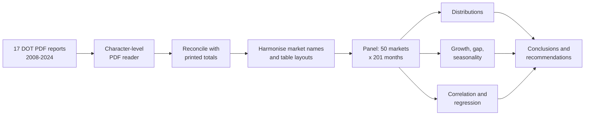

<div align="center">

# 🌏 After the World Fell Silent

### The Rise, Collapse and Unfinished Comeback of Philippine Tourism

*Philippine Tourism Trends by Market, 2008–2024*


-5B8C5A?style=for-the-badge)


**17 PDF reports · 50 source markets · 201 months of data · 2008–2024**

</div>

---

## 📑 Table of Contents

- [Overview](#-overview)
- [Business Question](#-business-question)
- [Headline Numbers](#-headline-numbers)
- [Key Findings](#-key-findings)
- [Recommendations](#-recommendations)
- [Methodology](#-methodology)
- [Repository Structure](#-repository-structure)
- [Notebook Contents](#-notebook-contents)
- [Data](#-data)
- [Getting Started](#-getting-started)
- [Data Notes and Limitations](#-data-notes-and-limitations)
- [Team](#-team)
- [References](#-references)

---

## 🧭 Overview

Behind every international arrival in the Philippines is a booked flight, an occupied hotel room, a hired guide and a meal bought from a local business. Visitor arrivals show how connected the country is to the rest of the world, and which parts of the world are most connected to it.

From 2008 to 2019 the story was steady growth. In early 2020 travel almost stopped. By 2024 the country had recovered to about 72% of its 2019 level. The recovery is real, but it is **unfinished** and it has **not been shared equally** between source markets.

This project analyses the Department of Tourism's own visitor-arrival statistics. The tables sit inside yearly PDF reports whose layouts change over time, so a large part of the work is reading them correctly, reconciling them with the totals printed in the reports, and building one consistent dataset.

> **A caution that runs through the analysis:** when many series rise together they look closely related even if they have little else in common. Whenever a strong relationship appears, we test whether it survives once the shared trend is removed.

---

## ❓ Business Question

> **How fast has international tourism to the Philippines grown since 2008, which source markets drove that growth, and how did COVID-19 change the way markets move relative to each other?**

Sub-questions:

1. How are monthly arrivals distributed (centre, spread, shape, outliers)?
2. How fast did total and market arrivals grow before COVID-19, and how much had been recovered by 2023 and 2024?
3. Which markets account for the remaining gap to 2019, and is there a seasonal pattern?
4. How strongly are two markets' monthly arrivals related, and is that relationship real or just a shared trend?

---

## 📊 Headline Numbers

| Metric | Value |
|---|---|
| Arrivals in 2008 | 3,139,422 |
| Arrivals in 2019 | 8,260,913 |
| Growth 2008–2019 (CAGR) | **9.2% a year** |
| Peak month (Jan 2020) | 796,164 |
| Lowest month (Apr 2020) | 948 |
| Change in 2020 / 2021 | −82.1% / −88.9% |
| Arrivals in 2023 | 5,450,557 (66% of 2019) |
| Arrivals in 2024 | 5,949,350 (**72% of 2019**, +9.2% vs 2023) |

### Recovery by market (Jan–Oct 2023 as % of Jan–Oct 2019)

| Market | Pre-COVID growth (CAGR 2008–19) | Recovered by 2023 |
|---|---|---|
| 🇺🇸 USA | 5.7% | **85.1%** |
| 🇰🇷 Korea | 11.3% | **72.7%** |
| 🇯🇵 Japan | 6.0% | **43.5%** |
| 🇨🇳 China | 24.0% | **14.9%** |

---

## 🔍 Key Findings

**1. Strong, steady growth until 2019.** Arrivals grew 9.2% a year. The only dip was 2009 (−3.9%) during the global financial crisis.

**2. COVID-19 was a structural break, not an ordinary bad year.** Monthly arrivals fell by more than 99% between January and April 2020, so pre-COVID growth rates cannot simply be carried forward.

**3. The recovery is real, but unfinished and uneven.** A single national figure hides very different stories across markets.

**4. China accounts for almost half of the remaining gap.** Comparing Jan–Oct 2023 with Jan–Oct 2019, the 50 core markets are 2,655,646 arrivals short:

| Market | Share of the gap |
|---|---|
| China | **48.1%** |
| Korea | 16.5% |
| Japan | 12.1% |
| USA | 4.9% |
| Taiwan | 4.4% |

China was the fastest-growing market before the pandemic, so it had the most to lose, and so far it has regained the least. Its share of all arrivals (Jan–Oct) fell from 22.1% in 2019 to 5.8% in 2024, while Korea's rose to 27.1% and the USA's to 17.8%. *(2024 market figures are indicative, see [Data Notes](#-data-notes-and-limitations).)*

**5. Markets look linked mainly because they all grew over the same years.**

| Check | Result |
|---|---|
| Korea vs China, correlation of levels (pre-COVID) | r = 0.83 |
| Same pair after removing each series' linear trend | r = **0.14** |
| Median correlation across 8 markets, levels | 0.75 |
| Median correlation across 8 markets, year-over-year growth | **0.10** |

**6. The close links after COVID were mostly a "reopening effect".** As the reopening faded, the Korea–China rolling correlation fell from 0.95 to 0.61 by October 2023, and the window covering January–December 2024 gives 0.49, close to the pre-COVID within-year median of 0.40.

**7. Clear yearly seasonality.** After adjusting for trend, January (115.8) and December (115.5) are the busiest months, with February, March and July (107.0) also above average. September (82.5) and October (88.7) are the quietest.

---

## 💡 Recommendations

1. **Keep Korea and the USA as anchor markets, but do not rely on them alone.** A larger share from fewer markets means trouble in one of them would hurt more than before 2020.
2. **Make rebuilding China the first priority.** It is the largest part of the remaining gap. The data cannot say why China is still low, so check flights, visa rules and travel preferences first.
3. **Plan promotions, staff and capacity around the yearly pattern.** Prepare for the busy months from December to March and in July, and use offers or events to lift September to November.
4. **Set targets and monitor by market, not only by national total.** Compare each market with the same month in 2019 and the same month last year.

---

## 🛠 Methodology



Highlights of the approach:

- **Custom PDF extraction.** The PDF text layer splits some numbers (for example `179,900` comes back as `1` and `79,900`), so each line is rebuilt from individual characters.
- **Reconciliation.** Extracted country rows are checked against the subtotals and grand totals printed in each PDF. For 2009–2021 the gap is zero, and the 2019 grand total matches the official DOT figure.
- **Four table layouts, one panel.** Market names are mapped across layouts, and the basis of each year (residence or nationality) is flagged in the data.
- **Honest treatment of gaps.** Missing months stay blank instead of being filled with zeros or interpolated.
- **Trend-aware statistics.** Year-over-year log growth, detrended correlations, Newey-West confidence intervals, Cook's distance and rolling correlations guard against mistaking a shared trend for a real link.

---

## 📁 Repository Structure

```text
EDA-Group-6/
├── data/
│   ├── raw/                          # 17 original DOT PDF reports (2008.pdf ... 2024.pdf)
│   └── processed/
│       ├── data_cleaned.xlsx         # long format: month x market
│       └── data_monthly_summary.xlsx # one row per calendar month
├── notebooks/
│   └── Group6_Midterm_Lab_Notebook_EDA.ipynb
└── README.md
```

---

## 📓 Notebook Contents

| Section | Focus |
|---|---|
| 1–2 | Business question, data source and variables |
| 3 | Data extraction from PDF, cleaning and quality checks |
| 4 | Univariate analysis I: distributions |
| 5 | Univariate analysis II: growth and recovery, remaining gap, composition, seasonality |
| 6.1–6.2 | Bivariate: correlation matrices, Korea vs China regression |
| 6.3–6.4 | Bivariate: correlation by period, rolling correlation |
| 7 | Conclusions, recommendations, limitations |

---

## 🗂 Data

| Item | Detail |
|---|---|
| **Source** | Philippine Department of Tourism (DOT) visitor-arrival statistics |
| **Link** | https://remote.tourism.gov.ph/tourism/demand-statistics/ |
| **Format** | 17 yearly PDF reports, read directly by the notebook (no pre-compiled spreadsheet) |
| **Unit** | One row per month and source market |
| **Coverage** | January 2008 to December 2024: 204 calendar months, 201 with data |
| **Markets** | 50 core markets, grouped into 7 regions |
| **Periods** | Pre-COVID (2008–2019), COVID (2020–2021), Recovery (2022–2024) |

The 50 core markets are those listed individually in every report from 2008 to 2021 **and** in the 2024 top-60 table. In 2019 they made up about 97% of all arrivals.

---

## 🚀 Getting Started

**1. Clone the repository**

```bash
git clone https://github.com/Ajooooooo/EDA-Group-6.git
cd EDA-Group-6
```

**2. Install the requirements**

```bash
pip install pandas numpy matplotlib seaborn scipy statsmodels pdfplumber openpyxl jupyter
```

**3. Run the notebook**

```bash
jupyter notebook
```

Open the notebook in `notebooks/` and run all cells. It finds the repository root automatically, whether launched from `notebooks/` or from the repository root, and needs the PDFs in `data/raw/`. The two processed Excel files are written to `data/processed/`.

---

## ⚠️ Data Notes and Limitations

- **Inconsistent source reports.** The 2022 report starts in February and counts air arrivals only, by nationality. The 2023 report stops in October. The 2024 report lists only the top 60 markets.
- **Three missing months:** January 2022, November 2023 and December 2023. They are left blank, not zero. The 2022 total covers February–December only.
- **2024 market figures are indicative.** The 2024 table has no separate overseas-Filipino row, and for each of the eight largest markets checked the 2024 figures look too high compared with 2023. 2023 is therefore the main benchmark against 2019. National totals are not affected.
- **Overseas Filipinos are part of the national total,** and their share changes a lot (0.9% in 2019, 23.7% in 2022, 8.3% in Jan–Oct 2023).
- **47 dash placeholders** in the core markets were treated as zero and flagged in the dataset (`was_dash`), so they can be reviewed or reversed.
- **Descriptive, not causal.** The data count arrivals only. There is nothing on spending, length of stay, visa rules, flight availability or conditions in visitors' home countries, so the analysis shows what happened, not why.

---

## 👥 Team

**DS311 Exploratory Data Analysis · Midterm Lab Exam · Group 6 (Culture and Tourism)**

| | | | |
|---|---|---|---|
| Aque | Badilla | Beturin | Dellosa |
| Ganhinhin | Pamplona | Ruiz | |

---

## 📚 References

- Philippine Department of Tourism, visitor arrival statistics: https://remote.tourism.gov.ph/tourism/demand-statistics/
- Group 6 repository with the yearly DOT PDF reports (`data/raw`): https://github.com/Ajooooooo/EDA-Group-6

---

<div align="center">

*Built for DS311 Exploratory Data Analysis · Group 6*

</div>
